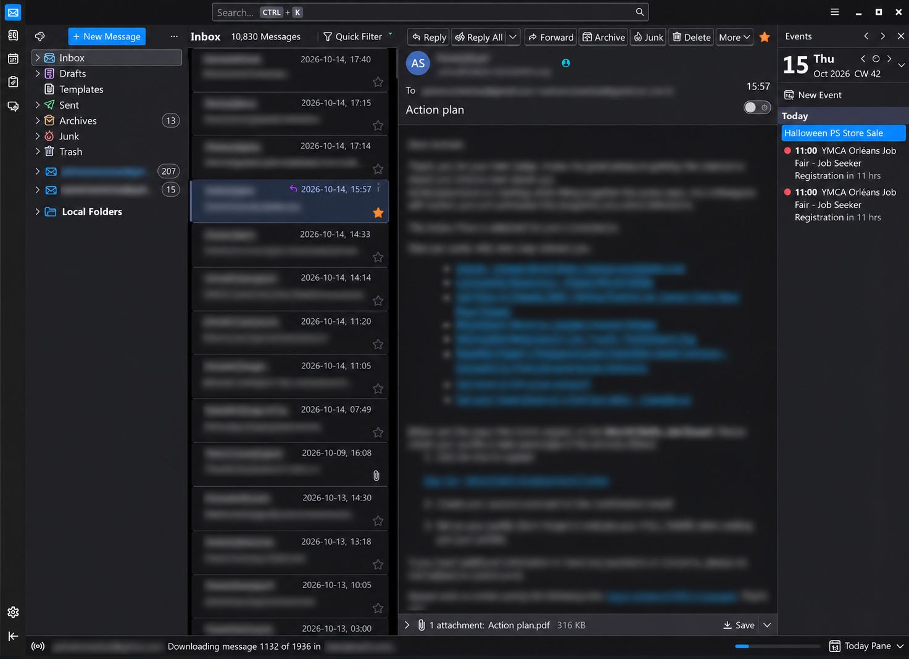

# 🐧 PEACEKEEPER
### The Chromebook that refused to remain a Chromebook

> **ChromeOS + Debian 13 + KDE Plasma 6 / Wayland**  
> *A field journal of small victories, questionable decisions, and a surprisingly capable Celeron.*

    

**Last updated:** 16 October 2026 · **Maintainer:** ashvin · **Machine:** PEACEKEEPER

> [!NOTE]
> This is a **record of the configuration that worked on this particular machine**, not a universal Chromebook installer. Items marked **Verified** were reported working; **Check** means the result needs validation after future updates; **Historical** means it was part of the journey but is no longer the current setup. A command in a code block is documentation, **not** a command to execute blindly.

---

## Contents

1. [The machine and the mission](#1-the-machine-and-the-mission)
2. [From ChromeOS to Debian dual boot — complete beginner's route](#2-from-chromeos-to-debian-dual-boot--the-complete-beginners-route)
3. [The great input-device rebellion](#3-the-great-input-device-rebellion)
4. [Audio: the silent treatment](#4-audio-the-silent-treatment)
5. [From XFCE to KDE Plasma Wayland](#5-from-xfce-to-kde-plasma-wayland)
6. [Keyboard layouts, shortcuts and screenshots](#6-keyboard-layouts-shortcuts-and-screenshots)
7. [Firefox, Spotify, networking and everyday software](#7-firefox-spotify-networking-and-everyday-software)
8. [Making a small Chromebook feel fast](#8-making-a-small-chromebook-feel-fast)
9. [Thunderbird: the graphite makeover](#9-thunderbird-the-graphite-makeover)
10. [Birdtray: the Wayland-versus-X11 diplomatic incident](#10-birdtray-the-wayland-versus-x11-diplomatic-incident)
11. [Battery indicator and session polish](#11-battery-indicator-and-session-polish)
12. [Known compromises and upgrade risks](#12-known-compromises-and-upgrade-risks)
13. [Diagnostics and quick recovery](#13-diagnostics-and-quick-recovery)
14. [Changelog and how to add the next fix](#14-changelog-and-how-to-add-the-next-fix)

---

## 1. The machine and the mission

| Component | PEACEKEEPER |
|---|---|
| Manufacturer / model | ASUS Chromebook CX1405CKA / CB1405CKA |
| Chromebook board | **AWASUKI** |
| CPU | Intel Celeron **N4500** (Jasper Lake) |
| Memory | **4 GB RAM** (as observed in earlier sessions; recheck if hardware variant differs) |
| Storage | **128 GB eMMC** |
| Original OS | ChromeOS 154.16805.0 (at initial setup) |
| Added OS | Debian **13 Trixie**, 64-bit |
| Current desktop | KDE Plasma **6.3.6**, **Wayland** |
| Initial desktop | XFCE, retained as fallback |
| Hostname | **PEACEKEEPER** (previously GALACTIC-PEACEKEEPER) |
| Locale | `en_CA.UTF-8` |
| Browser policy | **Firefox only** on Debian; no Chromium/Chrome installation |

**The mission:** preserve ChromeOS, install a real Debian desktop alongside it, get every piece of Chromebook hardware working, and avoid turning a lightweight machine into a benchmark for how slowly software can start.

**Outcome:** dual boot works; touchpad, keyboard, audio, KDE Plasma Wayland, screenshot shortcuts, Bluetooth, Spotify, Firefox, Thunderbird, SSHFS, power indicator and Birdtray were all reported working.

> **Philosophy:** A Celeron N4500 doesn't need more software. It needs *the right software*, preferably without 400 MB of “helpful” dependencies.

---

## 2. From ChromeOS to Debian dual boot — the complete beginner's route

**Outcome on PEACEKEEPER:** ChromeOS was preserved; Debian 13 (amd64) was installed on the internal eMMC; MrChromebox **RW_LEGACY / edk2** provides the alternative UEFI boot route. Debian initially ran XFCE, then KDE Plasma Wayland.

> [!CAUTION]
> **Read this chapter completely before running anything.** Enabling Chromebook Developer Mode **erases local ChromeOS user data**. Creating an installer USB **erases the USB drive**. Choosing the wrong partition in the Debian installer can **destroy ChromeOS and your files**. This is a supervised procedure with deliberate stop-and-check points, **not** a blind copy/paste script. If you're under 18, involve a technically competent adult before changing firmware or disk partitions.

### 2.1 The five things you're about to do

Think of the machine as having five layers:

| Layer | What it means | What we'll change |
|---|---|---|
| **ChromeOS** | The Google operating system already installed | **Keep it** |
| **Developer Mode** | Allows advanced boot options; weakens normal ChromeOS protections | Enable it |
| **Firmware** | Low-level software that starts before an OS | Add **RW_LEGACY**, **not Full ROM** |
| **Disk partitions** | Separate areas of the internal storage | Shrink ChromeOS data space; create Linux space |
| **Debian** | A separate operating system | Install it in the new space |

**RW_LEGACY ≠ UEFI Full ROM.** RW_LEGACY adds an alternative boot payload while preserving the stock ChromeOS firmware. **Full ROM replaces the normal boot firmware and is not the procedure described here.** On PEACEKEEPER the RW_LEGACY payload uses **edk2 (UEFI)**, so the Debian USB and installed system need to boot in UEFI mode.

### 2.2 Confirm your Chromebook is supported — BEFORE touching anything

PEACEKEEPER is an **ASUS CX1405CKA / CB1405CKA**, board **AWASUKI**, Intel Celeron **N4500** (64-bit x86), **128 GB eMMC**. **Don't assume your Chromebook is identical** just because the outside looks similar.

1. Visit [MrChromebox's supported devices documentation](https://docs.mrchromebox.tech/docs/supported-devices.html).
2. Find your **board name** and check whether **RW_LEGACY** is supported.
3. Read the [MrChromebox getting-started guide](https://docs.mrchromebox.tech/docs/getting-started.html).
4. Check the [Chrultrabook dual-boot partitioning guide](https://docs.chrultrabook.com/docs/installing/dualboot.html).
5. If support is absent or unclear, **stop**. A successful PEACEKEEPER installation does not establish compatibility for another model.

**What to gather:** the Chromebook and its charger, a separate Windows PC to prepare the USB, a **USB stick of at least 8 GB** (16 GB is comfortable), reliable internet, backups, and time. A USB mouse/keyboard can help if Chromebook-specific input drivers don't work immediately.

### 2.3 Back up ChromeOS and make recovery media

Before Developer Mode:

1. Copy files from **Downloads** and any other local folders to external storage or Google Drive. Google account sync is **not** a substitute for checking local files.
2. Record Wi-Fi passwords and any non-synced app data you need.
3. On another computer, prepare **ChromeOS recovery media** using the official [Chromebook Recovery Utility](https://support.google.com/chromebook/answer/1080595). Use a *separate* USB stick if possible.
4. Keep the Chromebook plugged in.

> [!WARNING]
> ChromeOS recovery media is an emergency escape hatch, **not** a guaranteed way to preserve an existing dual-boot installation. A full ChromeOS recovery generally overwrites the disk layout. Recovery can erase Debian.

### 2.4 Download Debian 13 — which ISO?

Use the **official Debian download pages**:

- [Debian 13 (Trixie) installer downloads](https://www.debian.org/releases/trixie/debian-installer/)
- [Debian amd64 installation manual](https://www.debian.org/releases/trixie/amd64/index.en.html)
- [Debian image checksums and verification information](https://www.debian.org/CD/verify)

For this **Intel** Chromebook, choose **amd64** (meaning 64-bit x86, **not** AMD-only). Do **not** choose arm64.

A beginner-friendly choice is the **amd64 netinst ISO**, which downloads extra packages during installation. It needs a working network connection; if Wi-Fi support is uncertain, consider an official larger installation image or a compatible USB Ethernet adapter.

1. Open the Debian installer downloads link.
2. Choose the **amd64 netinst** image.
3. Save the `.iso` file to your Windows PC's Downloads folder.
4. Check the image against Debian's published checksum/signature instructions if possible; do not trust a random third-party ISO mirror.

**Important:** Debian installer versions change. Download the current **Debian 13** image rather than hard-coding an old ISO filename.

### 2.5 Download Rufus on Windows and make the installer USB

**Rufus** is a small Windows program that writes an ISO to a USB stick so a computer can boot from it. It is **not** installed on the Chromebook.

Official website: **https://rufus.ie/** ([Rufus documentation](https://rufus.ie/)).

1. On the Windows PC, visit **rufus.ie** and download the **standard** or **portable** x64 version. The portable version is fine; no traditional installer is needed.
2. Insert your USB stick. **Copy anything important off it first.**
3. Run Rufus; approve the Windows administrator prompt if shown.
4. Under **Device**, select the **USB stick**, checking its capacity and name. **Do not select an external backup drive.**
5. Under **Boot selection**, choose **Disk or ISO image** → **SELECT** → your downloaded Debian `.iso`.
6. For a PEACEKEEPER-style **edk2/UEFI** boot, use **GPT** as the partition scheme and **UEFI (non CSM)** if Rufus exposes those choices. Rufus may select suitable defaults for a hybrid Debian ISO.
7. Leave other options at defaults unless the Debian/Rufus documentation specifically calls for a change.
8. Click **START**. Rufus may ask whether to use **ISO image mode** or **DD image mode**. Try its recommended/default mode first; if the USB fails to boot, recreate it using **DD image mode**.
9. Read the erase warning and confirm **only if the selected USB device is correct**.
10. Wait for **READY**, close Rufus and safely eject the USB.

**Common beginner mistake:** copying the `.iso` file onto a normal USB drive does **not** usually make it bootable. Rufus writes the ISO as boot media.

### 2.6 Enable Chromebook Developer Mode

**Warning: this erases local ChromeOS user data and reduces ChromeOS boot-security protections.** Back up first.

1. Shut down the Chromebook and connect the charger.
2. Hold **Esc + Refresh (↻)**, then press **Power**. Release when the recovery screen appears.
3. At the recovery screen, press **Ctrl + D**. Follow the on-screen confirmation, often **Enter**, to enable Developer Mode.
4. Allow the Chromebook to reset. This may take several minutes. Do **not** interrupt the reset.
5. On the Developer Mode / OS verification screen, **Ctrl + D** normally boots ChromeOS. Complete initial setup if needed.

The precise appearance of these screens varies with ChromeOS versions. Use the [MrChromebox Developer Mode guide](https://docs.mrchromebox.tech/docs/boot-modes/developer.html) if your screen differs.

> [!IMPORTANT]
> **Do not press Space to re-enable OS verification after you've installed Debian.** Leaving Developer Mode can wipe local data and disrupt your alternate-boot configuration.

### 2.7 Open the correct ChromeOS terminal (VT2)

This is a major trap for readers following older tutorials. **ChromeOS 117 and newer removed the `sudo` workflow from the normal crosh shell.**

1. Boot ChromeOS to its **login screen**.
2. Press **Ctrl + Alt + F2**. On Chromebook keyboards, the key may be represented by the **right-arrow (→)** top-row key.
3. Log in as **`chronos`**.
4. You should see a text-mode shell called **VT2**.

Do **not** use the Linux development environment (**Crostini / penguin**); it is a container and cannot flash Chromebook firmware. Also don't run the firmware utility from a root login shell.

Source: [MrChromebox Firmware Utility instructions](https://docs.mrchromebox.tech/docs/fwscript).

### 2.8 Install MrChromebox RW_LEGACY firmware

The **official** firmware script is:

```bash
cd
curl -LOf https://mrchromebox.tech/firmware-util.sh
sudo bash firmware-util.sh
```

**Read before pasting:** the characters in `-LOf` are **capital L, capital O, lowercase f**. This downloads the official script into your home directory and then executes it with elevated privileges. Inspect the [script source](https://github.com/MrChromebox/scripts) if you want to understand what you're running.

Inside the firmware utility:

1. Confirm the displayed **board/device** matches yours.
2. Select **Install/Update RW_LEGACY Firmware** (documented as **option 1**).
3. Read every prompt and allow the RW_LEGACY firmware installation to complete.
4. If offered a firmware payload type, use the **UEFI/edk2** option appropriate to the board and installation plan.
5. **Do not select “Install/Update UEFI (Full ROM) Firmware.”** That's a different, potentially destructive migration.
6. Exit the utility and reboot as instructed.

RW_LEGACY normally **does not require disabling hardware write protection**. No screwdriver or battery disconnect should be necessary for this path.

Read: [Official firmware utility](https://docs.mrchromebox.tech/docs/fwscript) and [Legacy/AltFw boot explanation](https://docs.mrchromebox.tech/docs/boot-modes/legacy.html).

**Expected outcome:** a Developer Mode boot screen offering the alternate boot route, usually **Ctrl + L** or **Alternative Bootloader**. On some newer Chromebooks, this opens a menu rather than booting immediately.

### 2.9 Make room for Debian WITHOUT erasing ChromeOS

This is the **highest-risk step**. A Chromebook disk is not laid out like a normal Windows laptop. ChromeOS uses multiple special partitions; blindly clicking **“Erase disk”** in the Debian installer will remove ChromeOS.

The [Chrultrabook dual-boot guide](https://docs.chrultrabook.com/docs/installing/dualboot.html) currently recommends **CRAP**, a ChromeOS-aware partitioning tool, to shrink the **stateful** ChromeOS partition without rearranging the system partitions.

**Do not run a random partitioning command copied from an old blog post.** The partition tool, available space, and exact disk layout must be checked for the reader's device.

On PEACEKEEPER, the goal was **roughly 64 GB for Debian** out of 128 GB eMMC. That is a **personal choice**, not a universal partition size.

Before changing anything, record the existing layout in the root-capable ChromeOS shell:

```bash
lsblk -o NAME,SIZE,FSTYPE,PARTLABEL,MOUNTPOINTS
```

Then follow the **current** Chrultrabook partitioning instructions linked above. Their current guide describes running their CRAP tool from **VT2 as root**; this is a **separate, explicitly privileged partitioning operation**, unlike the firmware utility's normal-user launch.

> [!CAUTION]
> **Mandatory stop-and-check:** after shrinking the ChromeOS data partition, confirm you have **unallocated/free space** intended for Linux. Do not proceed if you cannot clearly identify it. The precise PEACEKEEPER partition numbers and commands were not preserved in our conversation, so this journal **will not invent them**. The machine worked; that is not permission to guess `/dev/mmcblk0pN` on somebody else's laptop.

### 2.10 Boot the Debian installer USB

1. Shut down the Chromebook.
2. Insert the Rufus-prepared Debian USB.
3. Power on and choose the **Alternative Bootloader / Ctrl + L** route on the Developer Mode screen.
4. In the **edk2 UEFI** menu, use the boot menu (often **Esc**) to choose the USB device. The exact display depends on firmware version.
5. Select **Graphical install** or **Install** in Debian's boot menu.

If the USB isn't listed, **do not reinstall firmware blindly**. Check the USB image, Rufus settings, USB port, and UEFI boot mode. Try a different USB stick or Rufus **DD mode**.

### 2.11 Install Debian: every major installer decision

The Debian installer guides you through several screens:

| Installer screen | What to do |
|---|---|
| Language | Choose your preferred language |
| Location | Choose your country |
| Keyboard | Pick the closest layout; KDE can refine it later |
| Network | Connect to Wi-Fi if detected; otherwise use compatible USB Ethernet or offline media |
| Hostname | For our machine, `PEACEKEEPER` |
| Users/passwords | Create a normal user; protect credentials |
| **Partition disks** | Choose **Manual** — **never “Guided - use entire disk”** |
| Software selection | A modest desktop such as **XFCE** is a good starting point |
| Bootloader | Install **GRUB for UEFI** to the intended EFI System Partition, after verifying the disk layout |

**The manual partitioning checkpoint is not optional.**

- Locate the **free space** created in §2.9, not an existing ChromeOS partition.
- Create an **ext4 root filesystem** mounted at `/` in that free space.
- Swap can be configured later; do not create swap at the expense of a usable root partition without understanding the tradeoff.
- An EFI System Partition (ESP) is required for UEFI boot. The Chrultrabook guide notes that ChromeOS **partition 12** may be repurposed as an ESP in some stock layouts, **but do not assume partition 12 is safe on your machine**. Identify the ESP by its actual type, size and purpose and follow the current model-specific guide.
- Review the installer's **final partition summary** before accepting changes. If any ChromeOS data/system partition is unexpectedly marked **format**, **delete**, or **resize**, **cancel** and investigate.

> [!WARNING]
> There is **no safe universal copy/paste command** for repartitioning a Chromebook. Device names, existing partitions, EFI handling and free space vary. The exact partition choices are intentionally not supplied as fake “known good” commands.

Read the [Debian 13 amd64 installer manual](https://www.debian.org/releases/trixie/amd64/index.en.html), especially the chapters on partitioning and installing the bootloader.

### 2.12 First boot and confirming BOTH systems survive

1. When Debian finishes, shut down or reboot and remove the installer USB when prompted.
2. Choose **Alternative Bootloader / Ctrl + L**, then the Debian/GRUB boot entry.
3. Log into Debian. Verify basic hardware.
4. Reboot and choose **Ctrl + D** (ChromeOS) at the Developer Mode screen.
5. Confirm ChromeOS still starts. Then boot Debian again.

On Debian, gather a quick diagnostic snapshot:

```bash
cat /etc/os-release
uname -m
lsblk -o NAME,SIZE,FSTYPE,PARTLABEL,MOUNTPOINTS
findmnt /
```

Expected architecture is **`x86_64`**. The Debian release should identify **13 / trixie**. **Do not modify partitions merely because their names differ from an example.**

### 2.13 Problems we actually encountered on PEACEKEEPER

| Symptom | What we learned |
|---|---|
| Debian boots, but touchpad doesn't work properly | Fixed later with a **libinput pressure quirk** (§3.1) |
| Built-in keyboard initially unresponsive in Linux | Worked after investigation; final KDE layout configured (§3.2 and §6) |
| Sound missing | Chromebook-specific **SOF audio** setup needed (§4) |
| Bootloader works, Linux input doesn't | Boot firmware and Linux device drivers are **separate layers** |
| `i8042.reset` kernel option | **Did not solve** our keyboard issue |
| Desktop felt too heavy with unnecessary packages | Lean KDE and selective package removal (§8) |

**And yes, the machine still boots ChromeOS.** The trick is making sure the Chromebook gets two operating systems, not two opportunities to panic.

### 2.14 If something goes wrong

- **Can't enter Developer Mode?** Re-read the official recovery/developer-mode guides; managed school/work devices may restrict it. Do not bypass organizational restrictions.
- **MrChromebox option unavailable?** Confirm exact board support and that you're running in the correct ChromeOS VT2 shell.
- **Two beeps at Ctrl + L?** The alternate boot payload or flags may be missing; see [MrChromebox AltFw troubleshooting](https://docs.mrchromebox.tech/docs/boot-modes/legacy.html).
- **Installer doesn't see internal eMMC?** Stop and diagnose storage/controller support; never choose the USB drive as the target by accident.
- **Installer shows no free space?** Stop. The ChromeOS partition has not been safely shrunk.
- **Only ChromeOS boots?** Re-check the alternate boot route and UEFI/GRUB installation; do not format partitions to “fix” a boot menu.
- **ChromeOS damaged?** Use your prepared recovery media, understanding that a full recovery can erase the Debian installation.

### 2.15 Authoritative reading — bookmark these

| Resource | Why it matters |
|---|---|
| [MrChromebox Getting Started](https://docs.mrchromebox.tech/docs/getting-started.html) | Choosing RW_LEGACY versus Full ROM |
| [MrChromebox Firmware Utility](https://docs.mrchromebox.tech/docs/fwscript) | Correct command, menu, requirements |
| [MrChromebox Developer Mode](https://docs.mrchromebox.tech/docs/boot-modes/developer.html) | Recovery keys and VT2 access |
| [Chrultrabook Dual Boot](https://docs.chrultrabook.com/docs/installing/dualboot.html) | **Critical** ChromeOS-aware partition resizing |
| [Chrultrabook Linux Installation](https://docs.chrultrabook.com/docs/installing/installing-linux) | Linux compatibility and audio |
| [Debian 13 Installation Manual](https://www.debian.org/releases/trixie/amd64/index.en.html) | Installer and GRUB explanations |
| [Debian Official Downloads](https://www.debian.org/releases/trixie/debian-installer/) | Authentic installation images |
| [Rufus](https://rufus.ie/) | Windows USB installer creation |

**Historical accuracy note:** The exact partition-resize transcript, Rufus options chosen at the time, and initial installer screenshots were not preserved. The detailed workflow above is a **beginner-oriented reconstruction from current official documentation**, clearly separated from the **confirmed PEACEKEEPER outcome**. Do not mistake it for a byte-for-byte installation log.

---

## 3. The great input-device rebellion

### 3.1 Touchpad pressure quirk — **Verified**

**Symptom:** internal touchpad not usable correctly under Debian; eventually worked after login.

**Hardware identification:** `PNP0C50:00 093A:200F Touchpad`.

**Persistent fix:** `/etc/libinput/local-overrides.quirks`

```ini
[ASUS Awasuki Touchpad Pressure]
MatchName=PNP0C50:00 093A:200F Touchpad
MatchUdevType=touchpad
AttrPressureRange=35:25
AttrPalmPressureThreshold=250
```

This was the confirmed working local libinput override. The quirk survives ordinary package updates because it is a local `/etc` configuration file. After a major libinput upgrade, test tapping, dragging, palm rejection and behaviour at the login screen.

**Check:**

```bash
cat /etc/libinput/local-overrides.quirks
libinput --version
```

### 3.2 Keyboard — **Verified**

The keyboard worked in the boot environment but initially failed in the Debian session. After troubleshooting, it was working; the initial kernel-level recovery sequence is not fully documented, so **do not confuse the later layout fix with a hardware-driver fix**.

Under the original XFCE desktop, the stable layout was the Chromebook keyboard model with Canadian English:

```bash
setxkbmap -model chromebook -layout ca -variant eng
setxkbmap -query
```

Persistent XFCE values (historical; Plasma now manages its own layouts):

```text
/Default/XkbDisable = false
/Default/XkbModel   = chromebook
/Default/XkbLayout  = ca
/Default/XkbVariant = eng
```

**Why `ca(eng)`?** Other tested layouts, including `ca(fr)` and `fr-legacy`, produced awkward punctuation mappings (notably `/`). `ca(eng)` restored the expected dedicated slash key.

---

## 4. Audio: the silent treatment

**Status: Verified working, including speaker tray, volume OSD, media keys, mute, volume up and down.**

**Device:** Intel Jasper Lake HD Audio `8086:4dc8`, using the **SOF / rt5650** audio path.

The stock Debian installation did not immediately produce working Chromebook audio. The successful intervention was the community **chromebook-linux-audio** script from **WeirdTreeThing**, followed by testing in the real Plasma session.

**Result:** audio played correctly and the media keys worked.

> [!CAUTION]
> The exact script revision, invocation and files it changed were not preserved. Do **not** rerun a random copy of an online audio-fix script on a working machine. Before kernel or SOF firmware changes, capture current package versions and test sound after reboot.

Useful non-destructive diagnostics:

```bash
lspci -nn | grep -i audio
wpctl status
systemctl --user status wireplumber --no-pager
```

The sound of success was, for once, actual sound.

---

## 5. From XFCE to KDE Plasma Wayland

**Status: Verified.**

The first desktop was XFCE, a sensible lightweight starting point. We then moved to **KDE Plasma 6.3.6 running on Wayland**, keeping XFCE as a fallback.

**What worked:** Plasma session, window management, panel/system tray, media-key OSD, touchpad, audio, Spectacle and desktop effects. **Wobbly Windows** and **Magic Lamp** were enabled for fun. The traditional **Desktop Cube** is not included by default in this Plasma 6.3 setup.

The practical lesson: *modern Plasma can feel responsive on modest hardware when you avoid installing everything that happens to have a checkbox.* This is an observed experience, not a measured benchmark.

### Desktop screenshot gallery

The screenshots below are selected captures recovered from our earlier conversation. Captions are intentionally conservative where a screenshot's exact diagnostic context is uncertain.



*Recovered screenshot from the desktop-customization sessions, 15 October 2026.*

---

## 6. Keyboard layouts, shortcuts and screenshots

### 6.1 Plasma keyboard layouts — **Verified**

Two layouts were configured in KDE: **Canadian English** and **US International with dead keys**. KDE handles the active layouts in its own settings; don't apply the old XFCE `setxkbmap` startup configuration blindly to a Wayland session.

### 6.2 Spectacle selection → clipboard — **Verified**

**Goal:** select a rectangle and put it directly on the clipboard, without manually saving a PNG.

Working command:

```bash
spectacle -r -c -b -n
```

**Shortcut:** `Meta+Shift+S`.

There was a shortcut conflict; removing the conflicting custom assignment and then configuring the desired action made the shortcut work. Spectacle version was **6.3.5**.

**Test:** press `Meta+Shift+S`, select a region, then paste into an application.

### 6.3 Function/media keys — **Verified in Plasma**

The Chromebook media keys (volume and mute) functioned after the desktop/audio fixes. The keyboard layout was tuned for the actual Canadian-labelled Chromebook keyboard, rather than assuming a generic US PC keyboard.

---

## 7. Firefox, Spotify, networking and everyday software

### 7.1 Firefox-only browser policy — **Verified preference**

Firefox ESR is the chosen Debian browser. Chromium/Chrome were deliberately avoided to reduce duplicated browser installations and keep storage/RAM pressure down. WhatsApp Web was used through Firefox. Firefox ESR **153.4.0** was observed in a later session.

### 7.2 Spotify signing key — **Verified installation**

A Spotify APT repository key problem was fixed; the key fingerprint recorded during troubleshooting was:

```text
E109 6BCB FF6D 4187 96DE 7851 5384 CE82 BA52 C83A
```

Spotify was subsequently installed and running. For a future reinstall, follow the then-current official repository/keyring instructions; don't resurrect deprecated `apt-key` recipes merely because they're nostalgic.

### 7.3 SSHFS to DietPi — **Verified**

The remote DietPi filesystem is mounted at:

```text
/mnt/dietpi
```

A **systemd automount** was configured and a permissions issue was resolved. This allows PEACEKEEPER to browse remote storage without permanently mounting it during every login.

**Check without changing configuration:**

```bash
findmnt /mnt/dietpi
systemctl list-units --type=automount --all
```

The exact mount unit and remote target were not retained in the available notes. Read the current unit before reproducing it on another host.

### 7.4 Terminal locale and drawing characters — **Verified**

The locale was set to `en_CA.UTF-8`; `xterm-256color` and box-drawing characters worked. Handy sanity check:

```bash
locale
locale charmap
printf 'Unicode: ───── │ ┌──┐ ✓ é è à €\n'
```

---

## 8. Making a small Chromebook feel fast

**The rule:** *every megabyte is innocent until proven guilty; every unnecessary daemon is a suspect.*

### 8.1 Package cleanup — **Verified removals**

Removed as unnecessary for this installation:

- LibreOffice and GIMP, including an unneeded Swedish GIMP help package (`gimp-help-sv`).
- Unrelated firmware packages, including Netronome, AMD graphics, NVIDIA graphics and Marvell Prestera, after checking the Chromebook's hardware.
- IBus packages and orphaned dependencies when they were no longer needed.
- Extra Noto font bundles: `fonts-noto-extra`, `fonts-noto-cjk-extra`, `fonts-noto-ui-extra`.

Kept useful font coverage, including `fonts-noto-core`, `fonts-noto-cjk` and `fonts-noto-color-emoji`. The font cleanup alone saved roughly **600 MB**; disk use was observed around **22%** after cleanup.

> [!WARNING]
> This is a historical removal list, **not** a bulk purge command. Some packages may be dependencies on a future Debian version. Always preview removal transactions and verify actual hardware first.

### 8.2 Preferred APT workflow

```bash
sudo apt update
sudo apt -s full-upgrade       # inspect before major changes
sudo apt -s autoremove         # inspect proposed removals
```

For targeted installs, use `--no-install-recommends` when appropriate. Avoid `autoremove` without reading the transaction, particularly around kernels, audio and firmware.

### 8.3 IBus warning cleanup — **Verified package removal; session environment needed attention**

IBus warnings appeared in the KDE environment. IBus and its GTK/Hangul integration packages were removed because they weren't needed for the chosen keyboard layouts. Environment variables referencing IBus persisted in one session after removal; verify a fresh login rather than assuming a package purge clears inherited session variables.

```bash
printenv | grep -i ibus
```

Do not indiscriminately delete input-method settings if you later need complex-language input.

### 8.4 Performance observations — **Not benchmarked**

- Plasma Wayland felt responsive on the N4500.
- Unnecessary applications, font sets and background integrations were removed.
- No controlled ChromeOS-versus-Debian battery, memory or benchmark results have been collected.
- Real-world checks still worth doing: suspend/resume, idle drain, battery runtime, Wi-Fi/Bluetooth after wake and browser memory usage.

---

## 9. Thunderbird: the graphite makeover

**Status: Verified working.**

The original dark Thunderbird theme was too close to black. We created a more restrained **graphite / charcoal** palette with muted blue selections, then styled both the Thunderbird chrome and the message-reading surface.


*Recovered screenshot from the Thunderbird customization session.*

### 9.1 The profile and CSS locations

Thunderbird profile observed on PEACEKEEPER:

```text
/home/ashvin/.thunderbird/9a5vajr4.default-default/
```

The **correct** paths are:

```text
~/.thunderbird/9a5vajr4.default-default/chrome/userChrome.css
~/.thunderbird/9a5vajr4.default-default/chrome/userContent.css
```

**Important failed attempt:** placing `userChrome.css` at the *profile root* did nothing. It must be in the `chrome/` subdirectory. After moving it, the styling took effect.

In Thunderbird's Config Editor, enable:

```text
toolkit.legacyUserProfileCustomizations.stylesheets = true
```

### 9.2 Graphite palette

| Purpose | Colour |
|---|---|
| Toolbar / base graphite | `#252b34` |
| Folder pane | `#2b323d` |
| Thread list | `#292f39` |
| Message header | `#303743` |
| Selected row | `#355476` |
| Main text | `#e6eaf0` |
| Accent / links | `#58b4f5` |

The original full CSS files should be backed up from the live Thunderbird profile; this journal documents their placement and palette, not an invented replacement for every selector.

**Upgrade caveat:** Thunderbird may change internal selectors. The CSS files usually survive updates, but some visual rules can stop applying.

### 9.3 Remote content and privacy

Thunderbird's remote-content warning was discussed. Leaving remote content blocked is the privacy-preserving default; selectively allowing trusted senders is preferable to turning on every remote image globally.

---

## 10. Birdtray: the Wayland-versus-X11 diplomatic incident

**Status: Verified after logout/login.** Thunderbird starts hidden, Birdtray appears in the tray, and clicking the tray icon restores the window.

Birdtray package observed: **`1.9.0+ds-2+b2`**.

### 10.1 The original problem

Birdtray crashed with a **segmentation fault** when started using the default Qt Wayland platform. Starting it with Qt's XCB backend worked:

```bash
QT_QPA_PLATFORM=xcb birdtray
```

But native-Wayland Thunderbird windows could not be hidden reliably by this Birdtray setup. The working combination was **Birdtray on XWayland + Thunderbird on X11/XWayland**.

### 10.2 The working Thunderbird wrapper — **Verified**

Create:

```text
/home/ashvin/.local/bin/thunderbird-x11
```

Contents:

```sh
#!/bin/sh
export MOZ_ENABLE_WAYLAND=0
export GDK_BACKEND=x11
exec /usr/bin/thunderbird "$@"
```

Make executable:

```bash
chmod +x ~/.local/bin/thunderbird-x11
```

In **Birdtray → Settings → Advanced**, set **Thunderbird command line** to the executable path **only**:

```text
/home/ashvin/.local/bin/thunderbird-x11
```

**Failed attempt worth remembering:** entering `env MOZ_ENABLE_WAYLAND=0 GDK_BACKEND=x11 thunderbird` in that Birdtray field produced `execvp: No such file or directory`. Birdtray treated the whole string as an executable path, not a shell command. A wrapper script fixed it.

Window name pattern: `Mozilla Thunderbird`.

### 10.3 Birdtray KDE autostart — **Verified**

File:

```text
~/.config/autostart/birdtray.desktop
```

Contents:

```ini
[Desktop Entry]
Type=Application
Name=Birdtray
Comment=Thunderbird system tray integration
Exec=env QT_QPA_PLATFORM=xcb birdtray
Icon=birdtray
Terminal=false
X-KDE-autostart-after=panel
```

### 10.4 Birdtray settings — **Verified**

Under **Settings → Hiding**:

- **Start Thunderbird when Birdtray starts:** enabled.
- **And hide it:** enabled for background startup.
- **Hide/show Thunderbird window when clicking on tray icon:** enabled.
- **Hide Thunderbird window when it is minimized:** enabled.
- **Terminate Thunderbird when quitting Birdtray:** left **unchecked**.

A prompt about monitoring email folders appeared at startup. Choose **Don't ask again** if Birdtray is only needed for minimizing/restoring Thunderbird. Folder monitoring is optional.

**Behavioural detail:** minimize Thunderbird to hide it in the tray. The **X** close button may still quit Thunderbird; this configuration does not redefine Close as Minimize.

### 10.5 Don't force all Mozilla apps onto X11

If an earlier experiment created a global override, remove it **only if present and no longer needed**:

```bash
rm -f ~/.config/environment.d/thunderbird.conf
```

The wrapper scopes X11 settings to Thunderbird and avoids changing Firefox's display backend.

> **Lesson:** Wayland and X11 can coexist peacefully, provided you don't ask Birdtray to mediate international relations without a wrapper script.

---

## 11. Battery indicator and session polish

**Status: Verified after login.**

The battery indicator was initially missing from the minimal Plasma installation. Installing PowerDevil fixed the missing functionality:

```bash
sudo apt install --no-install-recommends powerdevil
```

After a later logout/login, the indicator was missing **visually**, but the fix was simple:

**Right-click system tray → Configure System Tray → Entries → Power and Battery → Always shown.**

The icon reappeared immediately. No reinstall required.

If the service itself fails in the future:

```bash
dpkg -l powerdevil upower | grep '^ii'
systemctl --user status plasma-powerdevil.service --no-pager
upower -e
```

Restart only if the service exists and is actually unhealthy:

```bash
systemctl --user restart plasma-powerdevil.service
```

**Lesson:** before rebuilding the power-management stack, check whether KDE has simply hidden the icon. Sometimes the dragon is just behind the curtain.

---

## 12. Known compromises and upgrade risks

| Area | Likely update resilience | What to verify |
|---|---|---|
| KDE preferences and shortcuts | High | Shortcuts, tray entries, effects |
| libinput touchpad quirk in `/etc` | High | Touchpad after new libinput/kernel |
| Chromebook audio fix | Medium | Speakers, mic, volume keys after kernel/SOF changes |
| Thunderbird custom CSS | Medium | Theme after Thunderbird major updates |
| Birdtray XWayland workaround | Medium | Autostart, hide/restore after Qt/KDE/Thunderbird changes |
| SSHFS systemd automount | High | Mount availability and permissions |
| RW_LEGACY / ChromeOS dual boot | Special care | Boot paths after firmware/ChromeOS updates |
| Battery life and suspend | Unmeasured | Test against ChromeOS on same hardware |

**Debian gains:** native Linux packages, host-level administration, KDE customization, systemd, SSHFS, development and server tools. **ChromeOS retains advantages:** integrated hardware tuning, verified-boot/security model (subject to Developer Mode), Android app support where available, and generally simpler automatic maintenance. Keeping both systems is the right compromise for this machine.

### Upgrade discipline

1. Check what APT intends to change before large upgrades.
2. Preserve a working older kernel where practical.
3. Reboot and test input, audio, suspend, tray and Birdtray.
4. Save configuration backups before major upgrades.
5. **Do not overwrite known-good configuration with untested snippets from the internet — including snippets in this journal.**

**Backup roadmap (not yet implemented):** VPS first, then PEACEKEEPER and DietPi. Avoid documenting a backup system as operational until one exists and a restore has been tested.

---

## 13. Diagnostics and quick recovery

These commands inspect the system without changing it:

```bash
# Identity and desktop
hostnamectl
cat /etc/os-release
uname -a
printf 'Session: %s\n' "$XDG_SESSION_TYPE"

# Storage and memory
lsblk -f
df -h /
free -h

# Input and locale
cat /etc/libinput/local-overrides.quirks
locale

# Audio and battery
wpctl status
upower -e
systemctl --user status plasma-powerdevil.service --no-pager

# Birdtray and Thunderbird
pgrep -a -f 'birdtray|thunderbird'
cat ~/.config/autostart/birdtray.desktop
cat ~/.local/bin/thunderbird-x11

# Network mount
findmnt /mnt/dietpi

# Package changes
apt history 2>/dev/null || true
zgrep -hE '^(Start-Date|Commandline|Install|Remove|Purge):' /var/log/apt/history.log* 2>/dev/null | tail -80
```

**If something breaks:** record the exact symptom, version and output *before* trying fixes. One change at a time. The goal is to repair PEACEKEEPER, not create a new archaeological layer.

---

## 14. Changelog and how to add the next fix

### 2026-10-16 — Beginner-friendly installation walkthrough

- Expanded §2 with official downloads, Rufus USB creation, ChromeOS Developer Mode, MrChromebox RW_LEGACY installation, partitioning safety checkpoints, Debian installer choices and dual-boot verification.
- Distinguished confirmed PEACEKEEPER outcomes from reconstructed beginner instructions; avoided inventing device-specific partition commands.

### 2026-10-15 — Thunderbird, Birdtray and power indicator

- Graphite Thunderbird styling verified with CSS in the profile's `chrome/` directory.
- Birdtray Qt Wayland crash bypassed using `QT_QPA_PLATFORM=xcb`.
- Thunderbird X11 wrapper added; Birdtray command-line parsing pitfall resolved.
- KDE autostart configured; after logging out and back in, Thunderbird started hidden as intended.
- Power-and-Battery tray entry restored using **Always shown**.
- This living journal was started.

### 2026-10-13–14 — Plasma polish

- KDE Plasma Wayland operational, media keys/audio and touchpad working.
- Spectacle rectangle-to-clipboard shortcut fixed.
- Firefox, Spotify and SSHFS operational.
- Unneeded fonts, packages and IBus integrations cleaned up.
- PowerDevil added to minimal Plasma setup.

### 2026-10-11–13 — The migration

- ChromeOS preserved; Debian 13 installed through RW_LEGACY/edk2 and GRUB.
- Keyboard/touchpad troubles investigated; libinput touchpad quirk and keyboard layout settled.
- Chromebook audio repaired with the WeirdTreeThing script.
- XFCE gave way to Plasma Wayland.

### Template for the next repair

Copy this block at the **top of the changelog** whenever we fix something:

```markdown
### YYYY-MM-DD — Short, memorable title

**Status:** Verified / Check / Historical  
**Symptoms:** What broke, and how to reproduce it.  
**Cause:** Confirmed root cause (or "not established").  
**Fix:** Exact commands, file paths and UI settings.  
**Validation:** What was tested, including reboot/login if relevant.  
**Rollback:** How to undo safely.  
**Screenshot:** `assets/descriptive-name.png` (if useful).  
**One-liner:** A little humour at the expense of the bug, not the user.
```

---

## Appendix: screenshots and source hygiene

This document references a small set of recovered conversation screenshots. They live in `assets/`, so the Markdown remains **one editable journal** while the images remain ordinary GitHub-friendly files. More screenshots can be added later with descriptive names and captions.

- `assets/thunderbird-graphite.png` — recovered desktop/customization capture.
- `assets/thunderbird-graphite.png` — recovered Thunderbird customization capture.

**Privacy check before publishing publicly:** screenshots can contain email addresses, subject lines, personal files, browser tabs and hostnames. Review and redact images before pushing to a public repository. Likewise, never commit passwords, tokens, private SSH keys, `.kdbx` files or full Thunderbird mail profiles.

**Evidence policy:** this journal combines user-confirmed outcomes and retained troubleshooting notes. Where exact historical commands or screenshots were unavailable, that is stated instead of inventing them. When we next have terminal access to PEACEKEEPER, we can enrich it with `dpkg` versions, actual systemd unit files, boot layout and current configuration hashes.

---

<p align="center"><strong>PEACEKEEPER</strong> · <em>Too old for ChromeOS boredom. Too stubborn to retire.</em> 🐧</p>
